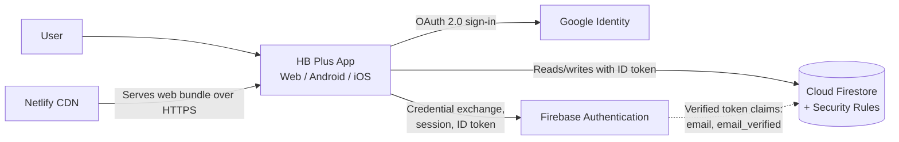
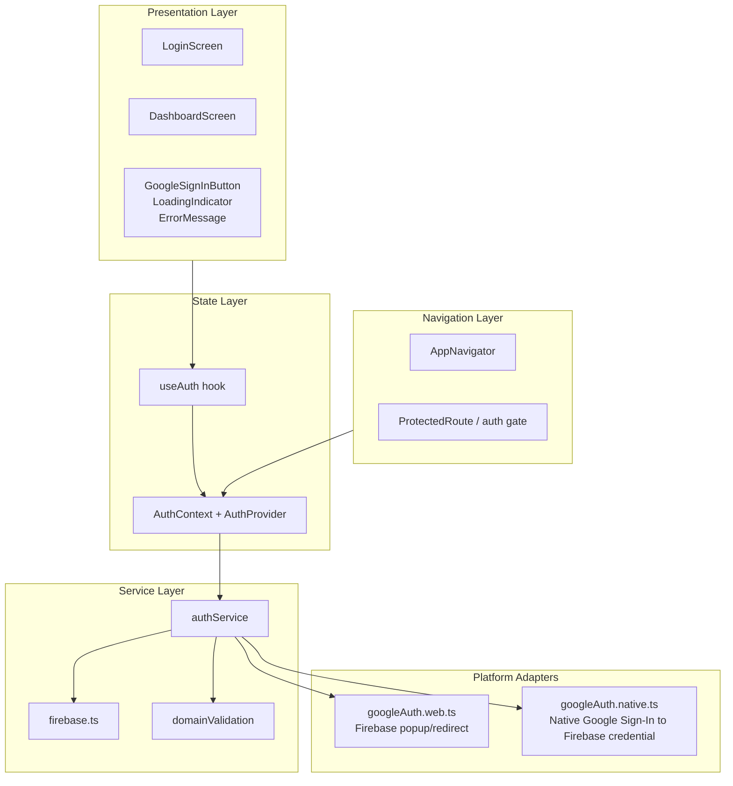
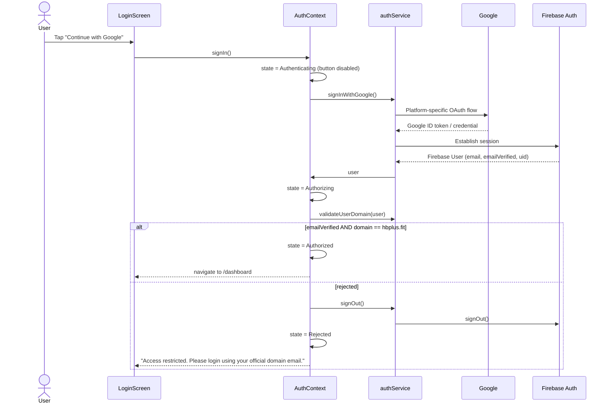
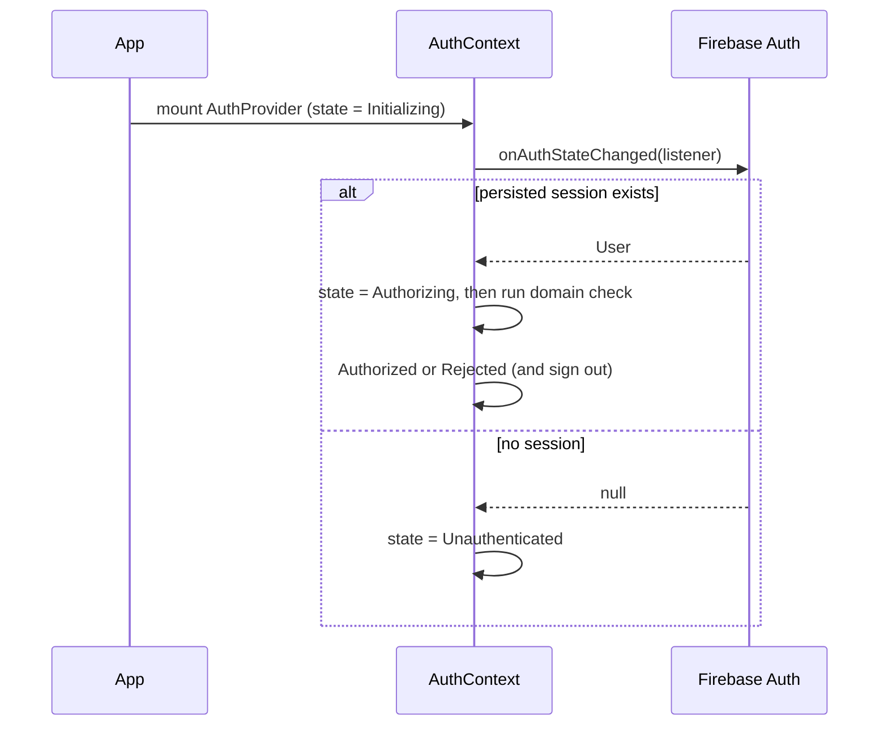
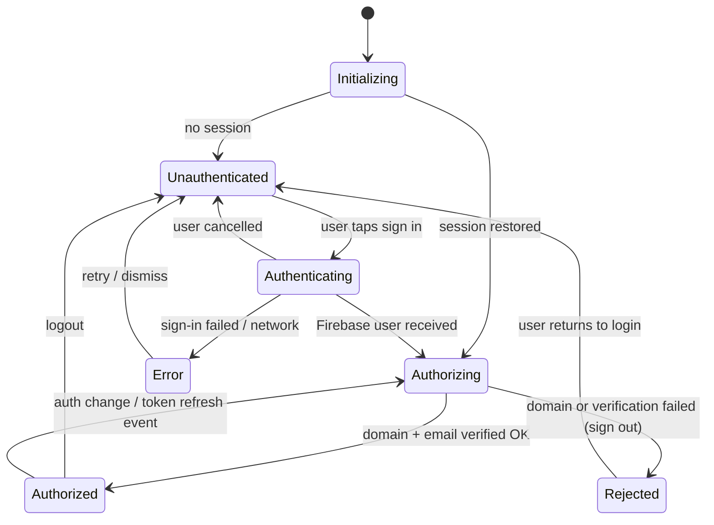
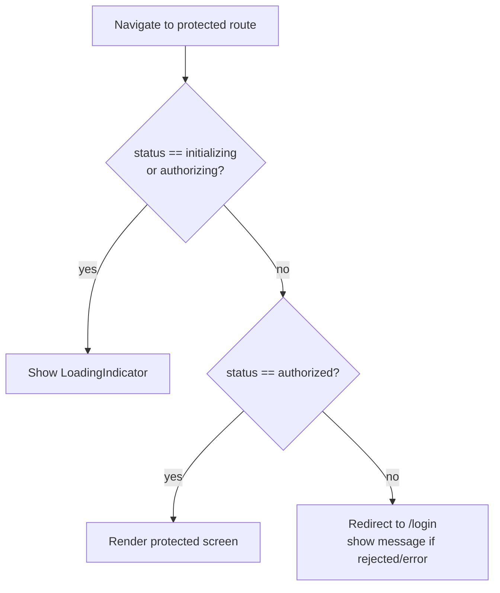
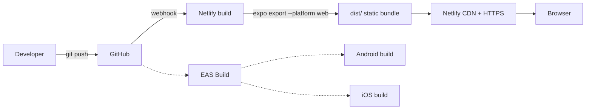

# Architecture Document

## HB Plus: Domain-Restricted Google Authentication App

**Version:** 1.0 (Draft)
**Derived from:** `PRD.md` v1.0
**Platforms:** Web, Android, iOS
**Stack:** Expo + React Native + React Native for Web + TypeScript + Firebase Authentication

---

## 1. Purpose and Scope

This document describes how the application defined in the PRD will be built. It covers system structure, authentication and authorization design, state management, navigation, platform-specific behavior, security controls, deployment, and testing. It is the technical companion to the PRD and should be updated if implementation decisions change.

**Core architectural principle:** the UI decides what to *show*; a trusted layer (Firebase Security Rules, or an optional backend verifying the ID token) decides what the user may *access*. Client-side domain checks are UX only (PRD FR-02, SEC-03, SEC-04).

---

## 2. Architectural Drivers

| Driver | Source | Architectural consequence |
|---|---|---|
| One codebase for web, Android, iOS | PRD 2.1, 5.2 | Expo + React Native for Web; platform-specific files only for the Google sign-in step |
| No custom password system | PRD 1.2 | Google OAuth 2.0 via Firebase Authentication |
| Only `@hbplus.fit` may access data | FR-02, SEC-03 | Client check + server-side enforcement in Firestore Security Rules (optionally blocking functions) |
| Rejected users must not stay signed in | SEC-07 | Auth layer signs out immediately after a failed domain check |
| Session survives refresh | US-03 | Firebase persistence (browser local on web, AsyncStorage on native) |
| Protected routes with deep links | Section 11 | React Navigation with linking config; Netlify SPA rewrite |
| No tokens in logs, URLs or app storage | SEC-05 | Firebase manages tokens; no manual token storage; sanitized error handling |

---

## 3. System Context



**External systems**

| System | Role |
|---|---|
| Google Identity | Authenticates the user and returns an identity assertion (ID token) |
| Firebase Authentication | Verifies the Google credential, creates the Firebase user, issues Firebase ID tokens, manages refresh |
| Cloud Firestore (optional but recommended) | Holds protected data and user profiles; enforces domain authorization in Security Rules |
| Netlify | Hosts the static web build with HTTPS and SPA routing |
| GitHub | Source control and (optionally) CI/CD trigger for Netlify |

---

## 4. High-Level Application Architecture



### Layer responsibilities

| Layer | Responsibility | Rule |
|---|---|---|
| Presentation | Render screens and components | No Firebase or Google SDK calls; read state via `useAuth()` |
| Navigation | Route definitions, guards, deep-link config | Guards read `AuthContext`; they never decide authorization themselves |
| State | Single source of truth for auth state (state machine) | Only `AuthProvider` mutates it |
| Service | All authentication logic (PRD 15.1) | Separate from UI; no React imports |
| Platform adapters | The only place web and native differ | Selected by Metro/Webpack file extension (`.web.ts`, `.native.ts`) |

---

## 5. Folder Structure

Matches PRD section 14, with the platform adapters added under `services/`.

```text
hbplus-auth/
├── src/
│   ├── components/
│   │   ├── GoogleSignInButton.tsx
│   │   ├── LoadingIndicator.tsx
│   │   └── ErrorMessage.tsx
│   ├── screens/
│   │   ├── LoginScreen.tsx
│   │   └── DashboardScreen.tsx
│   ├── navigation/
│   │   ├── AppNavigator.tsx
│   │   ├── ProtectedRoute.tsx
│   │   └── linking.ts              # URL <-> screen mapping for web deep links
│   ├── context/
│   │   └── AuthContext.tsx
│   ├── services/
│   │   ├── authService.ts          # public API used by AuthContext
│   │   ├── firebase.ts             # Firebase app + Auth init (platform persistence)
│   │   ├── googleAuth.web.ts       # web: Firebase GoogleAuthProvider popup/redirect
│   │   └── googleAuth.native.ts    # native: Google Sign-In -> GoogleAuthProvider.credential
│   ├── hooks/
│   │   └── useAuth.ts
│   ├── utils/
│   │   ├── domainValidation.ts
│   │   └── errorMapper.ts          # maps SDK errors to safe user-facing messages
│   ├── constants/
│   │   └── config.ts               # ALLOWED_DOMAIN, error strings, env access
│   ├── types/
│   │   └── auth.types.ts
│   └── styles/
│       └── theme.ts
├── firebase/
│   ├── firestore.rules             # trusted domain enforcement
│   └── firebase.json
├── public/
│   └── _redirects                  # Netlify SPA fallback (or netlify.toml)
├── assets/
├── .env.example
├── .gitignore
├── app.json
├── package.json
├── tsconfig.json
├── README.md
├── ARCHITECTURE.md
└── PRD.md
```

---

## 6. Authentication Architecture

### 6.1 Platform-specific sign-in

Both platforms end in the same place: a **Firebase user session**. Only the way the Google credential is obtained differs.

| Platform | Mechanism | Notes |
|---|---|---|
| Web | `signInWithPopup(auth, googleProvider)`; fall back to `signInWithRedirect` on browsers that block popups | Popup is simpler to develop; redirect is more reliable on mobile browsers |
| Android / iOS | Native Google Sign-In (for example `@react-native-google-signin/google-signin`) returns a Google ID token, then `signInWithCredential(auth, GoogleAuthProvider.credential(idToken))` | Requires an Expo development build (not Expo Go) with Android SHA-1 and iOS bundle ID configured |

`googleProvider.setCustomParameters({ hd: "hbplus.fit", prompt: "select_account" })` may be set on web to steer the account chooser toward the organization. **This is a UX hint only**; it can be bypassed and must never be treated as authorization.

### 6.2 Firebase initialization (`firebase.ts`)

- Config is read from environment variables (`EXPO_PUBLIC_FIREBASE_*`).
- **Web:** `browserLocalPersistence` (default) keeps the session across refreshes.
- **Native:** `initializeAuth(app, { persistence: getReactNativePersistence(AsyncStorage) })`.
- Firebase manages token storage and refresh. The app never reads or stores raw Google access tokens (SEC-05).

### 6.3 Auth service contract

```ts
// services/authService.ts
signInWithGoogle(): Promise<AuthResult>      // runs platform adapter, then domain check
signOut(): Promise<void>
getCurrentUser(): User | null
subscribeToAuthChanges(cb: (user: User | null) => void): Unsubscribe
validateUserDomain(user: User): DomainCheckResult
```

`AuthResult` is a discriminated union (`authorized | rejected | cancelled | error`) so the context never has to inspect raw SDK errors.

### 6.4 Sign-in sequence



### 6.5 Session restoration sequence



Re-running the domain check on every restored session means a user whose account changes cannot keep access through a stale local session.

---

## 7. Authorization Architecture

Authorization has **two independent layers**, as required by FR-02, SEC-03 and SEC-04.

| Layer | Where | Purpose | Trust level |
|---|---|---|---|
| 1. Client check | `domainValidation.ts` inside the app | Fast UX: show the error, sign out, guard routes | **Untrusted** (user controls the client) |
| 2. Server enforcement | Firestore Security Rules (and optionally a backend / blocking function) | Actually prevents data access | **Trusted** |

### 7.1 Client domain validation

Exact-match comparison against `hbplus.fit` after trimming and lowercasing, and requiring `emailVerified === true`. This satisfies the PRD matrix:

| Email | Result |
|---|---|
| `employee@hbplus.fit` | Allowed |
| `EMPLOYEE@HBPLUS.FIT` | Allowed (normalized) |
| `employee@gmail.com` | Denied |
| `employee@hbplus.fit.example.com` | Denied |
| `employee@sub.hbplus.fit` | Denied |
| `a@b@hbplus.fit`, empty, null | Denied |

The PRD's `isAllowedDomain` implementation is used as the base, with an added `emailVerified` check in `validateUserDomain`.

### 7.2 Server-side enforcement (Firestore Security Rules)

This is the layer that makes the "modify client-side authorization state → protected data stays inaccessible" test (PRD 16.2) pass.

```
rules_version = '2';
service cloud.firestore {
  match /databases/{database}/documents {

    function isOrgUser() {
      return request.auth != null
        && request.auth.token.email_verified == true
        && request.auth.token.email.lower().matches('^[^@]+@hbplus\\.fit$');
    }

    // Optional: authorized user profiles (PRD 12.2)
    match /users/{uid} {
      allow read:   if isOrgUser() && request.auth.uid == uid;
      allow create: if isOrgUser() && request.auth.uid == uid
                    && request.resource.data.email == request.auth.token.email;
      allow update: if isOrgUser() && request.auth.uid == uid
                    && !('role' in request.resource.data.diff(resource.data).affectedKeys());
      allow delete: if false;
    }

    // Example protected data the dashboard may read
    match /dashboard/{doc} {
      allow read: if isOrgUser();
      allow write: if false;
    }

    match /{document=**} {
      allow read, write: if false;
    }
  }
}
```

Key points:

- The decision uses `request.auth.token.*`, which comes from a Firebase-signed ID token, not from anything the client sends.
- The regex is anchored (`^...$`) so `hbplus.fit.example.com` and `sub.hbplus.fit` fail.
- Default deny for everything else.
- `role` cannot be self-assigned (PRD section 13).

### 7.3 Optional hardening: reject at sign-in time

For a stronger guarantee that rejected users never receive a session, Firebase Authentication with Identity Platform supports **blocking functions** (`beforeUserSignedIn`) that can throw for non-`@hbplus.fit` emails. This moves rejection into the auth layer itself. It requires upgrading to Identity Platform and Cloud Functions, so it is listed as an enhancement rather than a baseline requirement.

### 7.4 Optional backend

If the project later adds an API, every request must carry the Firebase ID token (`Authorization: Bearer <idToken>`), and the server must verify it with the Firebase Admin SDK, then check `email_verified` and the domain before returning data. Frontend route guards are never a substitute (SEC-04).

---

## 8. State Management

### 8.1 Auth state machine

States and transitions follow PRD section 8.3 and 8.4.



Only `Authorized` unlocks protected routes.

### 8.2 `AuthContext` shape

```ts
type AuthStatus =
  | "initializing" | "unauthenticated" | "authenticating"
  | "authorizing"  | "authorized"      | "rejected" | "error";

interface AuthContextValue {
  status: AuthStatus;
  user: AppUser | null;          // set only when status === "authorized"
  error: AuthErrorCode | null;   // code, never raw SDK message or token
  isLoading: boolean;            // true for initializing/authenticating/authorizing/sign-out
  signIn(): Promise<void>;
  signOut(): Promise<void>;
  clearError(): void;
}
```

Design notes:

- `user` is exposed to the UI **only** in the `authorized` state, so the dashboard cannot render protected info early (FR-04).
- A single `status` enum replaces several booleans, preventing impossible combinations.
- A re-entrancy guard in `signIn()` ignores calls while `authenticating`, preventing duplicate requests (FR-01, FR-06).
- No authorization flag is persisted locally; it is always recomputed from the Firebase user (SEC-01).

---

## 9. Navigation and Route Protection

### 9.1 Route map

| Route | Screen | Access |
|---|---|---|
| `/login` | `LoginScreen` | Public (redirects to `/dashboard` if already authorized) |
| `/dashboard` | `DashboardScreen` | `authorized` only |
| `*` | Fallback | Redirect to `/login` |

### 9.2 Guard decision logic



`ProtectedRoute` is implemented in `AppNavigator` by conditionally registering screens based on `status` (React Navigation's recommended auth flow). Unauthorized users are never given the dashboard screen in the navigator at all.

### 9.3 Web deep links

`linking.ts` maps `login` to `/login` and `dashboard` to `/dashboard` through React Navigation's `linking` prop. Native uses the same screen names with the app's URL scheme.

---

## 10. UI Architecture

- **Theme:** central `theme.ts` (colors, spacing, typography, breakpoints).
- **Responsive layout:** `useWindowDimensions()` with a centered container (`maxWidth` around 420px for the login card on desktop; full width with padding on mobile). No horizontal scrolling.
- **Touch targets:** at least 44 x 44 pt for buttons.
- **Accessibility:** `accessibilityRole`, `accessibilityLabel` on buttons, `accessibilityLiveRegion="polite"` on the error area, sufficient color contrast.
- **Components:**
  - `GoogleSignInButton`: shows spinner and is disabled while `isLoading`.
  - `LoadingIndicator`: full-screen variant for session restore, inline variant for button.
  - `ErrorMessage`: renders the mapped, safe message plus an optional Retry action (for network errors).

---

## 11. Error Handling Architecture

All SDK errors pass through `errorMapper.ts`, which converts them into a small set of app-level codes. The UI only ever sees the code and a pre-written message.

| Condition | Source | App code | Behavior |
|---|---|---|---|
| Wrong domain | `validateUserDomain` | `DOMAIN_NOT_ALLOWED` | Sign out, show: "Access restricted. Please login using your official domain email." |
| Missing / unverified email | `validateUserDomain` | `EMAIL_INVALID` | Sign out, show access restricted message |
| User closed popup / cancelled native sheet | `auth/popup-closed-by-user`, `auth/cancelled-popup-request`, native cancel code | `CANCELLED` | Return to login silently (no error banner) |
| Network failure | `auth/network-request-failed` | `NETWORK` | Show error with Retry |
| Popup blocked | `auth/popup-blocked` | `POPUP_BLOCKED` | Fall back to redirect flow |
| Expired / invalid session | token refresh failure | `SESSION_EXPIRED` | Clear state, show login |
| Firebase config problem | `auth/invalid-api-key`, `auth/configuration-not-found`, etc. | `CONFIG` | Show generic safe message; log diagnostic detail (dev only) |
| Anything else | catch-all | `UNKNOWN` | Generic message |

Rules: never render tokens or raw error objects; never `console.log` credentials or ID tokens; verbose diagnostics only when `__DEV__`.

---

## 12. Security Architecture

| PRD ref | Control | Implementation |
|---|---|---|
| SEC-01 | No trust in client-supplied identity | Identity comes only from the Firebase `User` object; no locally persisted "isAuthorized" flag |
| SEC-02 | Verified identity | Require `emailVerified === true`; server rules also check `email_verified` claim |
| SEC-03 | Authorization beyond the UI | Firestore Security Rules (section 7.2); optional backend verifying ID tokens |
| SEC-04 | Route protection is not security | Guards are UX; all protected data sits behind rules |
| SEC-05 | Token handling | Firebase SDK owns persistence/refresh; no manual token storage; nothing in URLs or logs |
| SEC-06 | Secrets in config | `EXPO_PUBLIC_*` client config only; `.env` gitignored; `.env.example` committed; no service account keys in repo |
| SEC-07 | No lingering session for rejected users | `signOut()` invoked in the rejection path before state is set to `rejected` |

**Threat model summary**

| Threat | Mitigation |
|---|---|
| Personal Gmail user signs in | Client rejects and signs out; Firestore rules deny all reads/writes regardless |
| User edits JS / local state to flip `authorized` | UI may render, but every data request is denied by rules |
| Domain spoofing (`hbplus.fit.evil.com`, `sub.hbplus.fit`) | Exact, anchored match on both client and rules |
| Unverified email claim | `email_verified` required in both layers |
| Firebase API key visible in bundle | Expected for Firebase web config; protection comes from Auth + Rules, plus restricting the key by HTTP referrer / app ID in Google Cloud Console |
| Session theft via XSS | Standard CSP headers on Netlify; no `dangerouslySetInnerHTML`; dependencies kept patched |
| Open redirect / token in URL | Redirect targets are fixed internal routes; Firebase redirect result handled in-memory |

**Firebase console hardening checklist**

- Enable only the Google provider.
- Restrict authorized domains to `localhost` and the Netlify production domain.
- Restrict the web API key by HTTP referrer.
- Deploy `firestore.rules` and verify with the Rules Playground / emulator.

---

## 13. Data Architecture

Authentication data comes from Firebase Auth; no database is required for the core assignment.

| Field | Source | Used for |
|---|---|---|
| `uid` | Firebase Auth | Stable user key |
| `displayName` | Google profile | Welcome message |
| `email` | Google profile | Domain check and display |
| `photoURL` | Google profile | Avatar (fallback initials if absent) |
| `emailVerified` | Firebase Auth | Authorization precondition |
| `role`, `createdAt` | Firestore `users/{uid}` (optional) | Bonus features only |

**Optional Firestore flow:** after reaching `authorized`, the app upserts `users/{uid}` (profile, `createdAt`). The write only succeeds if rules pass, so unauthorized users cannot create profile documents (PRD 12.2).

---

## 14. Configuration and Environments

### 14.1 `.env.example`

```bash
EXPO_PUBLIC_FIREBASE_API_KEY=
EXPO_PUBLIC_FIREBASE_AUTH_DOMAIN=
EXPO_PUBLIC_FIREBASE_PROJECT_ID=
EXPO_PUBLIC_FIREBASE_STORAGE_BUCKET=
EXPO_PUBLIC_FIREBASE_MESSAGING_SENDER_ID=
EXPO_PUBLIC_FIREBASE_APP_ID=

# Google OAuth client IDs (native sign-in)
EXPO_PUBLIC_GOOGLE_WEB_CLIENT_ID=
EXPO_PUBLIC_GOOGLE_IOS_CLIENT_ID=
EXPO_PUBLIC_GOOGLE_ANDROID_CLIENT_ID=

EXPO_PUBLIC_ALLOWED_EMAIL_DOMAIN=hbplus.fit
```

### 14.2 Environments

| Environment | Firebase project | Notes |
|---|---|---|
| Local | Dev project or Emulator Suite | `localhost` in authorized domains |
| Production | Production project | Netlify domain in authorized domains; env vars set in Netlify UI |

> Because `EXPO_PUBLIC_*` values are embedded in the client bundle, they must contain **only** public client configuration, never service account keys or secrets.

### 14.3 Mobile credentials

- **Android:** package name + SHA-1/SHA-256 fingerprints registered in Firebase; `google-services.json` supplied via Expo config (kept out of Git if it contains project-specific values the team treats as private).
- **iOS:** bundle identifier registered; `GoogleService-Info.plist` and URL scheme (reversed client ID) configured in `app.json`.
- Native Google Sign-In requires an **Expo development build** (EAS Build or `expo run:*`); Expo Go cannot load the native module.

---

## 15. Build and Deployment Architecture



### 15.1 Web (Netlify)

- **Build command:** `npx expo export --platform web`
- **Publish directory:** `dist`
- **SPA fallback** so `/dashboard` does not 404 (PRD 18.1). `public/_redirects`:

  ```
  /*  /index.html  200
  ```

- **Environment variables:** set in Netlify site settings.
- **Security headers** (via `netlify.toml`): `Content-Security-Policy` allowing Google/Firebase auth endpoints, `X-Content-Type-Options: nosniff`, `Referrer-Policy: strict-origin-when-cross-origin`, `X-Frame-Options: DENY`. Note: Firebase popup sign-in needs a permissive `Cross-Origin-Opener-Policy` (`same-origin-allow-popups`).
- **Firebase:** add the Netlify domain under Authentication > Settings > Authorized domains.

### 15.2 Mobile

- Development: `npx expo run:android` / `npx expo run:ios` (development build).
- Distribution (optional for assignment): EAS Build producing an APK / simulator build.
- Mobile is verified independently of the web deployment (PRD 18.3).

---

## 16. Testing Strategy

| Level | Tooling | Coverage |
|---|---|---|
| Unit | Jest | `domainValidation` (full matrix from section 7.1), `errorMapper`, auth state reducer/transitions |
| Component | React Native Testing Library | Login button disabled while loading, error rendering, dashboard shows user data only when authorized |
| Navigation / integration | RNTL + mocked `authService` | Unauthenticated deep link to `/dashboard` redirects to `/login`; logout returns to login |
| Rules | Firebase Emulator + `@firebase/rules-unit-testing` | Org user can read; Gmail user denied; unverified email denied; `hbplus.fit.example.com` denied; self-assigned `role` denied |
| Manual / E2E | Real devices, browsers | Real Google sign-in on web, Android, iOS; refresh persistence; logout; responsive widths |

**Mapping to PRD test tables**

| PRD test | Where it is verified |
|---|---|
| Gmail / other-domain / missing / invalid email rejected | Unit (domain matrix) + manual |
| Cancelled auth stays on login | Unit (errorMapper) + manual |
| Network failure shows retry | Component test with mocked failure |
| Dashboard without login redirects | Navigation integration test |
| Refresh while authorized stays in | Manual (web) |
| Modified client state cannot reach protected data | Rules tests in emulator |
| Responsive widths | Manual at desktop / tablet / mobile / native sizes |

---

## 17. Key Architecture Decisions

| ID | Decision | Rationale | Trade-off |
|---|---|---|---|
| ADR-01 | Expo + React Native for Web | Single codebase for three targets; fast setup | Some web-specific tuning needed; native sign-in needs a dev build |
| ADR-02 | Firebase Authentication | Built-in Google provider, token management, persistence on all platforms | Vendor lock-in; accepted for scope |
| ADR-03 | Platform adapter files (`.web.ts` / `.native.ts`) for sign-in only | Isolates the one area where platforms differ; keeps UI and business logic shared | Two code paths to test |
| ADR-04 | Domain enforcement in Firestore Security Rules | Gives a real trusted layer without running a server | Requires at least one protected Firestore resource to demonstrate enforcement |
| ADR-05 | Client check retained but treated as UX only | Immediate feedback and sign-out of rejected users | Brief window where a rejected user holds a Firebase session; mitigated by rules and optional blocking function |
| ADR-06 | Single `status` enum in `AuthContext` | Mirrors PRD state model; avoids contradictory flags | Slightly more verbose transitions |
| ADR-07 | React Navigation with conditional screen registration | Works on web (linking) and native; unauthorized users never get the protected screen | Needs `linking` config for URLs |
| ADR-08 | Netlify for web hosting | Simple static hosting, HTTPS, SPA rewrites | None significant |

---

## 18. Risks and Mitigations (Architecture View)

| Risk | Impact | Mitigation |
|---|---|---|
| Native Google Sign-In misconfigured (SHA-1, bundle ID, client IDs) | Mobile login fails | Follow Firebase setup checklist; test on device/emulator early (Milestone 3) |
| Popup blocked or COOP header issues on web | Web login fails | Redirect fallback; correct COOP header on Netlify |
| Rejected user briefly holds a Firebase session | Session exists until sign-out completes | Immediate `signOut()`; rules deny data; optional `beforeSignIn` blocking function |
| Rules misconfigured (too permissive) | Data exposed to non-org users | Emulator rule tests in CI; default-deny catch-all |
| Env vars missing in Netlify | Production auth broken | `.env.example`, README checklist, startup config validation that shows a safe error |
| Refresh loses session | Poor UX | Firebase persistence per platform; `initializing` state prevents redirect flicker |

---

## 19. Implementation Order (maps to PRD milestones)

1. **Setup:** `npx create-expo-app` (TypeScript), add `react-native-web`, folder structure, theme.
2. **Firebase:** create project, enable Google provider, wire `firebase.ts` with platform persistence.
3. **Auth service + adapters:** web popup flow first, then native flow on a dev build.
4. **Domain authorization:** `domainValidation`, `validateUserDomain`, sign-out-on-reject; write and test Firestore rules.
5. **State + navigation:** `AuthContext` state machine, `AppNavigator`, linking config, guards.
6. **UI:** login screen, dashboard, loading/error states, responsive layout.
7. **Testing:** unit, component, navigation, rules tests; manual cross-platform pass.
8. **Deployment:** Netlify build, `_redirects`, env vars, authorized domain, production sign-in check.
9. **Documentation:** README (setup, auth flow, domain restriction, limitations), live URL.

---

## 20. Known Limitations (Baseline)

- Only the exact domain `hbplus.fit` is allowed; subdomains and multiple domains are future work.
- No MFA, roles, or admin tooling in the baseline.
- Without Identity Platform blocking functions, rejection of non-org accounts happens immediately after sign-in rather than before session creation; data remains protected by Security Rules.
- Native Google Sign-In cannot run in Expo Go.
