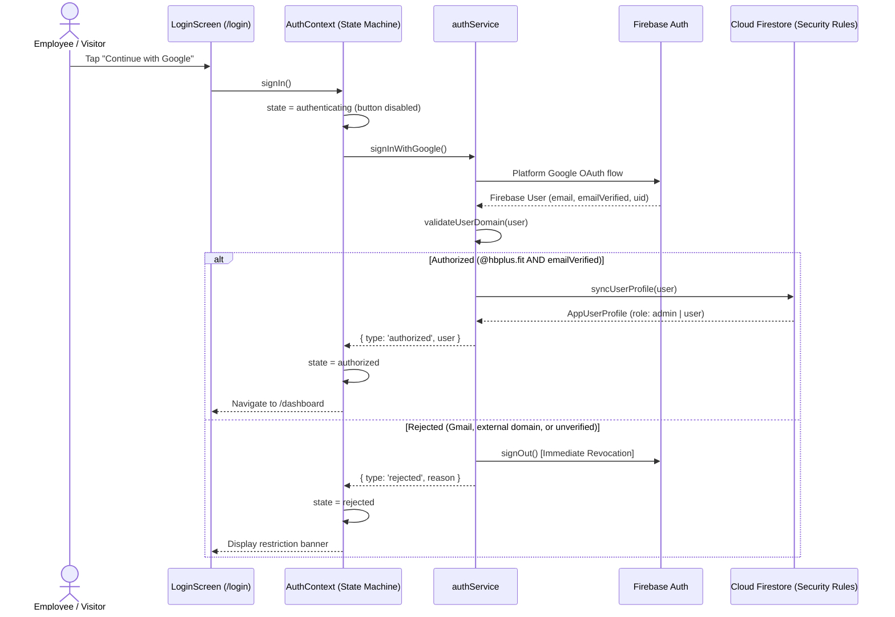

# HB Plus: Domain-Restricted Google Authentication Application

A secure, enterprise-grade, cross-platform authentication application built with **React Native**, **React Native for Web**, and **Expo**. The application restricts system access exclusively to verified users belonging to the official organizational domain:

```
@hbplus.fit
```

Users with personal Google accounts (`@gmail.com`) or any other corporate/external domains are strictly denied access and immediately signed out. Authorized users gain access to a protected dashboard, synchronized Firestore user profiles, and role-based permissions (Members vs. Administrators).

---

## Table of Contents

- [1. Project Overview & Features](#1-project-overview--features)
- [2. Technology Stack](#2-technology-stack)
- [3. System Architecture & Flow](#3-system-architecture--flow)
- [4. Prerequisites](#4-prerequisites)
- [5. Installation & Setup](#5-installation--setup)
- [6. Environment Configuration](#6-environment-configuration)
- [7. Firebase & Google OAuth Configuration](#7-firebase--google-oauth-configuration)
- [8. Domain Authorization & RBAC Logic](#8-domain-authorization--rbac-logic)
- [9. Running the Application (Web, Android, iOS)](#9-running-the-application-web-android-ios)
- [10. Automated Testing](#10-automated-testing)
- [11. Production Web Build & Netlify Deployment](#11-production-web-build--netlify-deployment)
- [12. Known Limitations & Security Guarantees](#12-known-limitations--security-guarantees)

---

## 1. Project Overview & Features

### Core Authentication & Authorization
- **Google OAuth 2.0 Integration**: Authenticate via Firebase Authentication using Google Sign-In.
- **Strict Domain Authorization**: Enforces access exclusively for the `@hbplus.fit` domain. Rejects all other domains with the required message:
  > *"Access restricted. Please login using your official domain email."*
- **Immediate Rejection Sign-Out (SEC-07)**: If a user signs in with an unapproved domain, the application immediately executes `signOut()` before setting state to `rejected`, ensuring no unauthorized active sessions linger.
- **Session Persistence**: Sessions survive application page refreshes and app restarts via platform persistence (`browserLocalPersistence` on web, `AsyncStorage` on native).
- **Safe Error Sanitization**: SDK errors and network failures are mapped to user-friendly messages without leaking sensitive tokens or internal stack traces.

### Role-Based Access Control & User Profiles (Mandatory Bonus Features)
- **Firestore User Synchronization**: Automatically provisions and synchronizes user documents in Cloud Firestore (`users/{uid}`) upon first authorized login with audit timestamps (`createdAt`, `lastLoginAt`).
- **Role Assignment**: Supports two privilege tiers:
  - **Member (`user`)**: Can view personal dashboard, profile details, and session identity.
  - **Administrator (`admin`)**: Can access the internal **Admin User Management Console** (`/admin`) to inspect all registered `@hbplus.fit` members and promote/demote user roles.
- **Elevation Prevention**: Standard users cannot modify their own `role` field; role transitions are guarded by server-side Firestore Security Rules.
- **Initial Admin Bootstrapping**: The email matching `EXPO_PUBLIC_INITIAL_ADMIN_EMAIL` (default: `admin@hbplus.fit`) is automatically initialized with the `admin` role upon first login.

### Presentation & Navigation
- **Responsive Layout**: Designed for mobile browsers, desktop displays, and native mobile screens. Desktop viewports feature a centered card container (max width 440px for login, 1080px for dashboard).
- **Protected Navigation (React Navigation)**: Deep links (`/login`, `/dashboard`, `/admin`) are guarded via conditional screen registration. Unauthenticated users cannot navigate to or render protected screens.

---

## 2. Technology Stack

| Layer | Technologies |
|---|---|
| **Framework & Runtime** | Expo SDK 58, React Native (0.88), React 19, TypeScript |
| **Web Rendering** | React Native for Web (0.21), `@expo/metro-runtime` |
| **Authentication & Backend** | Firebase Authentication v11, Cloud Firestore |
| **Navigation** | `@react-navigation/native`, `@react-navigation/native-stack` |
| **Storage & Persistence** | `@react-native-async-storage/async-storage` |
| **Hosting & CI/CD** | Netlify (Static SPA with HTTPS & Security Headers) |
| **Testing** | Jest, ts-jest, Node test runner |

---

## 3. System Architecture & Flow



---

## 4. Prerequisites

- **Node.js**: `v20.0.0` or higher (verified on Node `v22.22.x`)
- **Package Manager**: `npm` (v10+ or v11+)
- **Git** installed
- (Optional for mobile development): Expo Go or Android Studio / Xcode for native development builds.

---

## 5. Installation & Setup

1. **Clone the repository**:
   ```bash
   git clone https://github.com/your-org/hbplus-auth.git
   cd hbplus-auth
   ```

2. **Install project dependencies**:
   ```bash
   npm install
   ```

3. **Verify TypeScript compilation**:
   ```bash
   npx tsc --noEmit
   ```

---

## 6. Environment Configuration

Copy the template `.env.example` to create your local `.env` file:

```bash
cp .env.example .env
```

Populate the variables with your Firebase project credentials:

```bash
# Firebase Client Configuration (Embedded at build time via EXPO_PUBLIC_)
EXPO_PUBLIC_FIREBASE_API_KEY=AIzaSyExampleKey1234567890abcdef
EXPO_PUBLIC_FIREBASE_AUTH_DOMAIN=hbplus-auth.firebaseapp.com
EXPO_PUBLIC_FIREBASE_PROJECT_ID=hbplus-auth
EXPO_PUBLIC_FIREBASE_STORAGE_BUCKET=hbplus-auth.appspot.com
EXPO_PUBLIC_FIREBASE_MESSAGING_SENDER_ID=123456789012
EXPO_PUBLIC_FIREBASE_APP_ID=1:123456789012:web:abcdef123456

# Google OAuth Client IDs (For Native Mobile Builds)
EXPO_PUBLIC_GOOGLE_WEB_CLIENT_ID=123456789012-webclient.apps.googleusercontent.com
EXPO_PUBLIC_GOOGLE_IOS_CLIENT_ID=123456789012-iosclient.apps.googleusercontent.com
EXPO_PUBLIC_GOOGLE_ANDROID_CLIENT_ID=123456789012-androidclient.apps.googleusercontent.com

# Domain Authorization & RBAC
EXPO_PUBLIC_ALLOWED_EMAIL_DOMAIN=hbplus.fit
EXPO_PUBLIC_INITIAL_ADMIN_EMAIL=admin@hbplus.fit
```

> **Security Note**: Never commit `.env` or sensitive service account credentials to Git. Client-side variables prefixed with `EXPO_PUBLIC_` are public by nature; security is enforced via Firebase Security Rules on the backend.

---

## 7. Firebase & Google OAuth Configuration

### A. Firebase Console Setup
1. Go to the [Firebase Console](https://console.firebase.google.com/) and create a project (e.g. `hbplus-auth`).
2. Navigate to **Build > Authentication > Sign-in method**:
   - Enable **Google**.
   - Set support email to your organization's administrative address.
3. In **Authentication > Settings > Authorized domains**, add:
   - `localhost`
   - Your Netlify production domain (e.g., `hbplus-auth.netlify.app`).

### B. Firestore Security Rules Deployment
Deploy the security rules located in [firebase/firestore.rules](file:///C:/Users/chlok/Downloads/HB++/firebase/firestore.rules) using the Firebase CLI or Console:

```bash
firebase deploy --only firestore:rules
```

These rules enforce:
- Only verified `@hbplus.fit` accounts can read or write documents.
- Standard users can only view and update their own document, and cannot alter their `role`.
- Admins can list all users and promote/demote roles.
- Default deny for all other resources.

---

## 8. Domain Authorization & RBAC Logic

### Client-Side Domain Check
Located in `src/utils/domainValidation.ts`:
- Trims and normalizes the email to lowercase.
- Checks that the domain after `@` strictly equals `hbplus.fit`.
- Rejects subdomains (e.g. `sub.hbplus.fit`) and look-alike suffix extensions (`hbplus.fit.evil.com`).
- Requires `emailVerified === true`.

### Server-Side Rule Check
Located in `firebase/firestore.rules`:
```javascript
function isOrgUser() {
  return request.auth != null
    && request.auth.token.email_verified == true
    && request.auth.token.email.lower().matches('^[^@]+@hbplus\\.fit$');
}
```

---

## 9. Running the Application (Web, Android, iOS)

### Run on Web
Start the Expo Metro bundler with web support:
```bash
npm run web
```
The application will open at `http://localhost:8081` (or next available port).

### Run on Android
```bash
npm run android
```

### Run on iOS
*(macOS with Xcode required)*
```bash
npm run ios
```

---

## 10. Automated Testing

Run the automated test suite with Jest:

```bash
npm test
```

### Test Coverage
- **`__tests__/domainValidation.test.ts`**: Verifies the full authorization matrix, including exact domain matches, uppercase normalization, Gmail rejection, subdomain rejection, spoofing attempts, and verification state checks.
- **`__tests__/errorMapper.test.ts`**: Verifies error translation, silent handling of user cancellations, and outputting the exact PRD restriction banner.

---

## 11. Production Web Build & Netlify Deployment

### 1. Generate Static Web Bundle
```bash
npm run build:web
```
This runs `npx expo export --platform web`, outputting static HTML, assets, and optimized JavaScript bundles into the `dist/` directory.

### 2. Netlify SPA Configuration
The project includes [public/_redirects](file:///C:/Users/chlok/Downloads/HB++/public/_redirects) and [netlify.toml](file:///C:/Users/chlok/Downloads/HB++/netlify.toml) configured with:
- **SPA Rewrites**: `/* /index.html 200` to prevent 404 errors when directly accessing `/dashboard` or `/admin`.
- **Security Headers**:
  - `X-Frame-Options: DENY`
  - `X-Content-Type-Options: nosniff`
  - `Referrer-Policy: strict-origin-when-cross-origin`
  - `Cross-Origin-Opener-Policy: same-origin-allow-popups` (required for Google OAuth popup handling)

### 3. Deploy via Netlify CLI or Git
- **Publish directory**: `dist`
- **Build command**: `npx expo export --platform web`
- Ensure all `EXPO_PUBLIC_*` environment variables are configured in Netlify's **Site configuration > Environment variables**.

---

## 12. Known Limitations & Security Guarantees

1. **Exact Domain Requirement**: Only the exact domain `@hbplus.fit` is permitted. Subdomains (`@corp.hbplus.fit`) are intentionally rejected by security design.
2. **Backend Security Boundary**: Client-side domain validation provides immediate UI feedback. Real security is backed by Firestore Security Rules validating cryptographic ID token claims.
3. **Native Mobile OAuth**: Native Google Sign-In requires an Expo development build (`npx expo run:android` or EAS Build) with matching SHA-1 fingerprints registered in Google Cloud Console.
